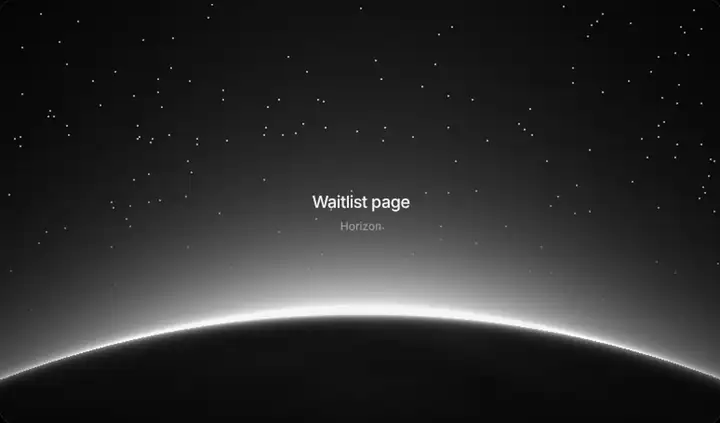

<div align="center">

# kavynUI

**101 animated React components and page sections. Monochrome, installed as source you own.**

[Browse the catalog](https://kavynui.com/components) · [Sections](https://kavynui.com/blocks) · [Backgrounds](https://kavynui.com/backgrounds) · [Docs](https://kavynui.com/docs)

[](https://github.com/Aseel012/kavynui/actions/workflows/ci.yml)
[](LICENSE)

</div>

<p align="center"></p>

```bash
npx shadcn@latest add https://kavynui.com/r/liquid-button.json
```

That command copies one `.jsx` file into your project, adds `motion` if you don't have it, and writes the theme tokens into your CSS. There is no `kavynui` package in your `node_modules` afterwards, and nothing to upgrade. The file is yours to edit.

## Why this exists

Most animated component libraries look great in the demo and then fight the product you put them in: a purple gradient here, a neon glow there, six different ideas of what an accent color is.

kavynUI takes the opposite bet. Every component is drawn in the same ten grays, so anything you install sits next to anything else, and next to your own UI, without a redesign. The shader backgrounds go one step further: they read `--bg` and `--tx` at runtime, so the same file is light-on-black in dark mode and ink-on-paper in light mode. The motion carries the personality. Color is left to you, and changing it is one CSS variable.

Each component is also built for a job, not a mood. The catalog doesn't file `hold-to-confirm` under "cool buttons"; it files it under *delete account*. `breath-dots` is *AI thinking*. `terminal-replay` is *CLI docs*. If a piece had no real use case, it got cut.

## Quick start

You need React and a Tailwind v4 project with shadcn initialized (`npx shadcn@latest init`).

**1. Register the library once**

```bash
npx shadcn@latest registry add @kavynui=https://kavynui.com/r/{name}.json
```

**2. Install by name**

```bash
npx shadcn@latest add @kavynui/hold-to-confirm
```

**3. Import the default export**

```jsx
import HoldToConfirm from '@/components/kavyn/hold-to-confirm'

export default function DangerZone() {
  return <HoldToConfirm label="Hold to delete" duration={1.4} onConfirm={() => deleteAccount()} />
}
```

Files land in your configured components folder under `kavyn/`. Shared helpers (the WebGL canvas, the world-map dots) come along automatically with the components that need them.

Don't want the CLI? Every component page on the site has the source with a copy button. Paste the file anywhere.

## A landing page in one command

Seven of the sections are designed to stack in the order a page reads. This installs a full page:

```bash
npx shadcn@latest add @kavynui/product-hero @kavynui/feature-bento @kavynui/pricing-morph @kavynui/faq-accordion @kavynui/wordmark-footer
```

```jsx
import ProductHero from '@/components/kavyn/product-hero'
import FeatureBento from '@/components/kavyn/feature-bento'
import PricingMorph from '@/components/kavyn/pricing-morph'
import FaqAccordion from '@/components/kavyn/faq-accordion'
import WordmarkFooter from '@/components/kavyn/wordmark-footer'

export default function Page() {
  return (
    <>
      <ProductHero title="Ship the site. Skip the servers." />
      <FeatureBento />
      <PricingMorph />
      <FaqAccordion />
      <WordmarkFooter brand="acme" />
    </>
  )
}
```

The [home page](https://kavynui.com/#page-kit) has a builder for this: switch sections on and off (social proof wall and globe CTA are there too), watch the real blocks stack, and copy the generated command and `page.jsx`.

## What's inside

| Family | Count | What it's for | A few of them |
| --- | :-: | --- | --- |
| Sections | 11 | Whole page sections, in the order a page reads | `product-hero` `pricing-morph` `sign-in-card` `status-board` |
| Buttons | 6 | Calls to action that answer the cursor | `liquid-button` `magnet-pill` `hold-to-confirm` |
| Forms & inputs | 4 | Capture emails, photos and files | `waitlist-form` `avatar-upload` `dropzone` |
| Navigation | 11 | Headers, menus, tabs and steps | `pocket-nav` `dock-magnify` `command-rail` `tab-lens` |
| Text | 8 | Headlines with timing and texture | `text-scramble` `flip-words` `odometer-figures` |
| Cards & layout | 10 | Feature grids, bento tiles and surfaces | `spotlight-card` `beam-border` `device-unveil` |
| Social proof | 3 | Reviews, logos and community | `review-rail` `logo-constellation` `avatar-orbit` |
| Interactive | 10 | Things people tap, drag and open | `share-sheet` `morph-dialog` `before-after-blade` `terminal-replay` |
| Maps & data | 9 | Dashboards, maps and live metrics | `traffic-map` `edge-globe` `uptime-bars` `request-heatmap` |
| Loaders | 4 | Waiting that feels designed | `breath-dots` `ring-weave` `stitch-progress` |
| Scroll & cursor | 7 | Stories that move as people read | `zoom-portal` `pinned-chapters` `word-light` |
| Backgrounds | 18 | Theme-aware shaders and canvases behind content | `shader-silk` `shader-chrome` `shader-horizon` `shader-rays` |

Plus 16 pure-CSS gradient backgrounds on the [backgrounds page](https://kavynui.com/backgrounds), each exportable as CSS, Tailwind classes or a React wrapper.

Full list with live previews: [kavynui.com/components](https://kavynui.com/components).

## Theming

The whole library reads ten CSS variables. They are added to your stylesheet on first install and mapped to Tailwind colors (`bg-panel`, `text-mute`, `border-line`, and so on).

| Token | Dark | Light | Used for |
| --- | --- | --- | --- |
| `--bg` | `#000000` | `#ffffff` | Page background |
| `--panel` | `#141416` | `#f5f5f7` | Cards and surfaces |
| `--panel2` | `#1f1f22` | `#e8e8ed` | Raised or nested surfaces |
| `--line` | `#262628` | `#e5e5ea` | Borders |
| `--line2` | `#3a3a3d` | `#d2d2d7` | Stronger borders |
| `--tx` | `#f5f5f7` | `#1d1d1f` | Body text |
| `--mute` | `#a1a1a6` | `#6e6e73` | Secondary text |
| `--faint` | `#6e6e73` | `#a1a1a6` | Tertiary text |
| `--acc` | `#f5f5f7` | `#1d1d1f` | Accent (buttons, highlights) |
| `--acc-fg` | `#000000` | `#ffffff` | Text on the accent |

Dark is the default and follows shadcn's `.dark` class; add `.light` for the light theme. To put your brand on everything, override two variables:

```css
:root, .light { --acc: #5b5bd6; --acc-fg: #ffffff; }
```

Canvas and WebGL components read `--bg` at runtime, so they redraw correctly when the theme flips.

## Motion that behaves

Animation is the part of a UI library most likely to hurt the page it's on, so these are enforced rather than promised:

- **WebGL has a floor.** Shader backgrounds paint a CSS gradient first and fade the GPU version in only once it's running. If WebGL is missing, lost, or software-rendered, visitors keep the gradient.
- **Nothing animates unseen.** Canvas and shader loops stop when the element scrolls off screen or the tab is hidden.
- **Reduced motion is respected.** With `prefers-reduced-motion`, canvases render a single still frame.
- **Contrast is tested.** CI fails if body text drops below WCAG AAA or secondary text below AA, in either theme.
- **One dependency.** Beyond React and Tailwind, the only package any component pulls in is [`motion`](https://motion.dev).

## Built for coding agents

The registry is discoverable by tools, not only by people:

```bash
npx shadcn@latest mcp init
```

With the registry added, shadcn's MCP server lets Claude Code, Cursor and similar agents search kavynUI by description (`npx shadcn@latest search @kavynui -q "profile photo"`) and install what they find.

| Endpoint | What it is |
| --- | --- |
| [`/llms.txt`](https://kavynui.com/llms.txt) | Short overview and install rules |
| [`/llms-full.txt`](https://kavynui.com/llms-full.txt) | Every component by family, with its install command |
| [`/r/registry.json`](https://kavynui.com/r/registry.json) | Index that shadcn search and MCP read |
| `/r/<slug>.json` | One item: full source, helpers, dependencies, tokens |

Each component page also has a **Copy for AI** button that produces a spec you can paste into a prompt.

## What it isn't

- **Not a base component kit.** There's no select, table or date picker here. Use shadcn/ui or Radix for those and kavynUI for the parts people remember.
- **Mostly not TypeScript yet.** The shader backgrounds are `.tsx`; the shadcn CLI strips the types automatically for JavaScript projects. Everything else is plain `.jsx` with JSDoc prop types, and works in TS projects.
- **Not an npm package.** There is no versioned API and no `npm update`. You get a file; improvements upstream don't reach you unless you reinstall it.

## Contributing

```bash
git clone https://github.com/Aseel012/kavynui.git
cd kavynui
npm install
npm run dev
```

### Add a component

```bash
npm run new -- price-flip --family cards --use "Pricing card"   # TypeScript (default)
npm run new -- shader-mist --shader                              # a shader background
npm run new -- plain-thing --family buttons --js                 # plain JSX
```

That writes `src/kavyn/<slug>.tsx` from a template that already follows the house rules, and adds the
catalog entry. Fill in the `description` and the TODO comment, then `npm test && npm run build`.

The catalog entry drives everything else with no page code: sidebar, search, the detail page and its
Customize panel, the registry JSON, the static page and share image, the sitemap and `llms.txt`. The
tests pick it up too. Tag it `featured` for the home showcase, or give a section a `kit` role to add it
to the page builder.

### House rules

- Theme tokens only. No hardcoded hex colors.
- Works in dark and light.
- Has a real `useCase`. "Looks cool" isn't one.
- `'use client'` on the first line, and nothing touches `window` or `document` while rendering (tested: every component is server-rendered).
- No requests to other servers: no remote images, fonts or APIs by default (tested). People paste these into sites with strict CSPs, and every remote asset leaks their visitors' IPs.
- No `innerHTML`, `eval` or `new Function` (tested). Links that open a new tab use `noopener`.
- Imports only from `react`, `motion` or files the registry ships (tested).

### Checks

```bash
npm run lint              # unused code, hook rules
npm run typecheck         # the TypeScript components
npm run check             # catalog, stray files, CSP
npm test                  # unit: catalog, server render, safety, playground, color audit, contrast
npm run build && npx vite preview --port 4173 &
npm run registry:verify   # every item against shadcn's schema, sources byte-identical
npm run test:install      # installs every component into a fresh TS app, type-checks, builds
JS=1 npm run test:install # same for a JavaScript app
npm run e2e               # real Chrome: page kit, search, theme, filters, uploads
node scripts/smoke.mjs    # every route, fails on any console error
```

Browser scripts use `CHROME=/path/to/chrome`. Run smoke with `LIGHT=1` or `MOBILE=1` for the other modes; CI runs all three on every pull request.

### Project layout

| Path | What lives there |
| --- | --- |
| `src/kavyn/` | The library. One file per component, plus shared helpers |
| `src/data/catalog.json` | Single source of truth for everything the site and registry show |
| `src/data/gradients.js` | CSS backgrounds and their CSS / Tailwind / React generators |
| `src/pages/`, `src/site/`, `src/docs/` | The documentation site |
| `scripts/` | Registry, SEO and static-page generators, scaffolding, verification, install/e2e/smoke tests, clip recorder |
| `public/r/` | Generated registry (don't edit by hand) |

Site stack: React 19, Tailwind CSS v4, Motion, React Router, Vite.

## Recording clips

```bash
npm run build && npx vite preview --port 4173 &
npm run clip -- shader-silk                       # clips/shader-silk.mp4, ready for X / LinkedIn
npm run clip -- hold-to-confirm --square          # 1:1 crop
npm run clip -- shader-horizon,shader-rays --seconds 3 --webp   # one reel, plus a WebP for GitHub
```

## Sponsors

kavynUI is free and MIT. Sponsors get a logo on the [home page](https://kavynui.com) and here.
Six spots. Write to [shaikhmdaseel@gmail.com](mailto:shaikhmdaseel@gmail.com?subject=Sponsoring%20kavynUI).

## Templates

The component library is free and stays free. Separately, [kavynui.com/templates](https://kavynui.com/templates) sells complete multi-screen product designs as source you own. Buying one is the most direct way to support the project.

## License

[MIT](LICENSE). Use it in personal and commercial work. Attribution is appreciated, not required.

Built by [Shaikh Aseel](https://shaikhaseel.vercel.app). If kavynUI saved you an afternoon, a star helps other people find it.
